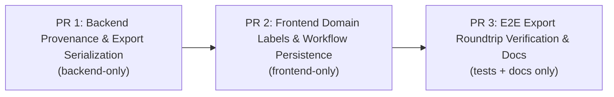

# BATCH C36 SPEC: RESEARCH SYNTHESIS, PROVENANCE & EXPORT COMPLETENESS (SPEC-FIRST)

## 1. Thông Tin & Baseline
- **Batch**: C36
- **Tên**: Research Synthesis, Provenance & Export Completeness
- **Baseline Git HEAD**: `5820bad` (nhánh `main`)
- **Trạng thái**: Draft / Spec-First — Chờ Founder phê duyệt trước khi bắt đầu Test-First.
- **Tác giả**: Senior Software Engineer / QA Engineer

---

## 2. Mục Tiêu & Tầm Nhìn Sản Phẩm
Sau khi hoàn tất Batch C31 (AI Solution Coach), Batch C34 (Advanced TRIZ: ARIZ, Evolution, Resource) và Batch C35 (Domains, 6 Lenses, Workflow Profiles), Creative Research Workbench đã sở hữu năng lực toàn diện trong việc phát hiện mâu thuẫn, tra cứu nguyên lý sáng chế và định hướng nghiên cứu liên ngành.

Tuy nhiên, khâu **Kết xuất Tri thức (Export & Synthesis)** hiện vẫn đang dừng lại ở các hợp đồng từ Phase 9 (tháng 10/2026), dẫn đến việc:
1. Toàn bộ ghi chú tạo từ các công cụ mới (ARIZ, Evolution, Resource, AI Coach) bị mất huy hiệu ngữ cảnh nguồn khi xuất ra Markdown.
2. File snapshot JSON bị mất thông tin `domain` và `tags`, gây suy hao dữ liệu khi sao lưu hoặc khôi phục phiên nghiên cứu.
3. Giao diện frontend thiếu nhãn tiếng Việt cho 2 domain mới (`healthcare`, `sustainability`) và form tạo phiên thủ công chưa cho phép chọn 3 domain mới.
4. Lựa chọn Workflow Profile bị reset về mặc định mỗi khi tải lại trang do chưa được lưu trữ bền vững.

**Mục tiêu cốt lõi của Batch C36**:
Đồng bộ hóa toàn diện hệ thống Xuất bản (Export Markdown/JSON), hoàn thiện hiển thị lĩnh vực và bảo toàn tính truy nguyên (Provenance & Traceability) xuyên suốt vòng đời phiên nghiên cứu mà không làm biến động cơ sở dữ liệu.

---

## 3. Phạm Vi Triển Khai (In-Scope & Out-of-Scope)

Theo chỉ thị phê duyệt và điều chỉnh bắt buộc từ Founder, Batch C36 được chia tách ranh giới nghiêm ngặt giữa 3 PRs:

### 3.1. In-Scope Theo Từng PR

#### 🔹 PR 1: Backend-Only — Provenance & Export Serialization Enrichment
- **Phạm vi tệp**:
  - `backend/src/app/services/session_export_service.py`
  - `backend/src/app/services/ai_report_service.py`
  - `backend/tests/unit/test_session_export_service.py`
  - `backend/tests/unit/test_ai_report_service.py`
- **Nội dung kỹ thuật**:
  1. `export_session_as_json`:
     - Bổ sung `domain` (`session.domain`) và `tags` (`session.tags or []`) vào payload `session_payload`.
  2. `export_session_as_markdown`:
     - Bổ sung `domain: "{session.domain}"` vào YAML Frontmatter.
     - Hiển thị thông tin Lĩnh vực nghiên cứu trong phần metadata Overview.
     - Mở rộng bộ phân giải ngữ cảnh nguồn `source_context` trong ghi chú để hỗ trợ đủ 4 nguồn mới:
       - `triz_ariz`: `| Nguồn: Thuật giải ARIZ [Bước {step_id}: {step_title}]`
       - `triz_evolution`: `| Nguồn: Quy luật Tiến hóa [{pattern_name}]`
       - `triz_resource`: `| Nguồn: Ma trận Tài nguyên [{resource_group}]`
       - `ai_coach`: `| Nguồn: AI Solution Coach [{suggestion_type}]`
     - Áp dụng triệt để hàm `escape_markdown_inline` cho tất cả các chuỗi metadata mới để ngăn chặn Markdown/HTML injection.
  3. `ai_report_service.py`:
     - Làm giàu payload snapshot gửi sang LLM/Rule-based synthesis với thông tin `domain` và thống kê phân bổ nguồn ghi chú.

#### 🔹 PR 2: Frontend-Only — Domain Labels, Creation Options & Workflow Persistence
- **Ràng buộc nghiêm ngặt**: Chỉ giới hạn ở đúng 3 thay đổi UI, KHÔNG thêm badge provenance trong PR 2.
- **Phạm vi tệp**:
  - `apps/web/lib/utils.ts`
  - `apps/web/features/session/session-list.tsx`
  - `apps/web/features/session/workflow-profile-guidance.tsx`
  - `apps/web/lib/__tests__/utils.test.ts`
  - `apps/web/features/session/__tests__/session-list.test.tsx`
  - `apps/web/features/session/__tests__/workflow-profile-guidance.test.tsx`
- **Nội dung kỹ thuật**:
  1. `apps/web/lib/utils.ts`:
     - Bổ sung nhãn tiếng Việt cho `healthcare`: `'Y tế / Sức khỏe'`.
     - Bổ sung nhãn tiếng Việt cho `sustainability`: `'Môi trường / Bền vững'`.
  2. `apps/web/features/session/session-list.tsx`:
     - Mở rộng `DOMAIN_OPTIONS` trong form tạo session thủ công thêm đúng 3 domain mới: `healthcare`, `education`, `sustainability`.
  3. `apps/web/features/session/workflow-profile-guidance.tsx`:
     - Lưu trữ lựa chọn profile của người dùng vào `localStorage` với key có namespace rõ ràng và versioning: `crw:session:${sessionId}:workflow-profile:v1` (tránh xung đột và dễ migrate tương lai).
     - Khi khởi tạo component, tự động phục hồi profile đã lưu từ `localStorage` (fallback về `standard_triz` nếu chưa có hoặc lỗi).
     - Bổ sung prop `sessionId?: string` cho `WorkflowProfileGuidance`. Khi `sessionId` rỗng/undefined, fallback về key `crw:session:default:workflow-profile:v1`.

#### 🔹 PR 3: Tests & Docs Only — E2E Export Roundtrip Verification & Documentation
- **Ràng buộc nghiêm ngặt**: Chỉ giới hạn ở E2E Export Roundtrip và tài liệu, KHÔNG thêm badge UI trong PR 3.
- **Phạm vi tệp**:
  - `backend/tests/integration/test_c36_export_synthesis_integration.py` (Mới)
  - `apps/web/features/session/__tests__/c36-export-roundtrip-integration.test.tsx` (Mới)
  - `docs/ADR-017-research-synthesis-and-export-completeness.md` (Mới)
  - `docs/DEPLOYMENT_GUIDE.md` (Cập nhật mục hướng dẫn xuất bản & snapshot toàn vẹn)
  - `docs/IMPLEMENTATION_ROADMAP.md` (Đánh dấu hoàn tất Batch C36)
- **Nội dung kỹ thuật**:
  1. Backend Integration Test:
     - Khởi tạo session với domain mới (`healthcare` / `sustainability`), nạp các ghi chú từ đủ 4 nguồn (`triz_ariz`, `triz_evolution`, `triz_resource`, `ai_coach`).
     - Xác minh `GET /api/v1/sessions/{id}/export/markdown` xuất đủ metadata frontmatter và chuỗi nguồn chuẩn hóa.
     - Xác minh `GET /api/v1/sessions/{id}/export/json` chứa đầy đủ `domain`, `tags` và `source_context`.
     - Kiểm tra Roundtrip: Nạp JSON snapshot vào `session_import_service` bảo đảm không suy hao dữ liệu.
     - Bao phủ Edge Case: Kiểm tra phiên nghiên cứu không có domain (`domain = null` hoặc chuỗi rỗng `""`), bảo đảm quá trình import không crash và fallback an toàn sang `None`.
     - Tuân thủ Zero Testcontainers: Sử dụng in-memory/test double dependency override.
  2. Frontend Integration Test:
     - Giả lập (mock) client layer gọi `exportSessionMarkdown` và `exportSessionJson`, xác minh trigger download blob thành công và hiển thị trạng thái loading/error chính xác.
  3. Tài liệu hóa:
     - Hoàn thiện ADR-017 và cập nhật Roadmap.

### 3.2. Out-of-Scope (Ngoài phạm vi)
- KHÔNG tạo bảng mới hoặc sửa đổi cột trong cơ sở dữ liệu PostgreSQL (Zero DB Migration, giữ nguyên `006 (head)`).
- KHÔNG thêm bất kỳ thư viện npm hoặc gói python bên ngoài nào (Zero New Dependencies).
- KHÔNG thêm bất kỳ domain, lens 9-windows, hoặc workflow profile mới nào.
- KHÔNG thêm badge UI trong PR 2 và PR 3 (giữ đúng ranh giới đã duyệt).
- KHÔNG deploy môi trường production.

---

## 4. Kiến Trúc Chi Tiết & Hợp Đồng Dữ Liệu

### 4.1. Hợp Đồng Markdown Frontmatter & Overview
```markdown
---
title: "Tối ưu hóa thiết bị lọc nước sinh học"
session_id: "550e8400-e29b-41d4-a716-446655440000"
domain: "sustainability"
status: active
workflow_state: ideation
created_at: 2026-11-19T08:00:00Z
updated_at: 2026-11-19T09:30:00Z
---

# Tối ưu hóa thiết bị lọc nước sinh học

> **Mã phiên nghiên cứu:** `550e8400-e29b-41d4-a716-446655440000`  
> **Lĩnh vực:** `sustainability` | **Trạng thái:** `active` | **Giai đoạn:** `ideation`  
> **Thời gian tạo:** 2026-11-19T08:00:00Z | **Cập nhật:** 2026-11-19T09:30:00Z
```

### 4.2. Hợp Đồng Định Dạng Nguồn Ghi Chú (Source Context Formatting)
Hàm định dạng trong `session_export_service.py` sẽ phân giải các cấu trúc ngữ cảnh sau:

| `source_type` | Cấu trúc dữ liệu trong `source_context` | Định dạng chuỗi xuất bản trong Markdown |
| :--- | :--- | :--- |
| `triz_ariz` | `{"source_type": "triz_ariz", "step_id": 2, "step_title": "Phân tích vùng xung đột"}` | ` | Nguồn: Thuật giải ARIZ [Bước 2: Phân tích vùng xung đột]` |
| `triz_evolution` | `{"source_type": "triz_evolution", "pattern_id": "pattern_3", "pattern_name": "Quy luật Tăng tính Linh hoạt"}` | ` | Nguồn: Quy luật Tiến hóa [Quy luật Tăng tính Linh hoạt]` |
| `triz_resource` | `{"source_type": "triz_resource", "resource_group": "Tài nguyên Thời gian"}` | ` | Nguồn: Ma trận Tài nguyên [Tài nguyên Thời gian]` |
| `ai_coach` | `{"source_type": "ai_coach", "suggestion_type": "solution_candidate"}` | ` | Nguồn: AI Solution Coach [solution_candidate]` |

### 4.3. Hợp Đồng JSON Snapshot
Trong `export_session_as_json`, đối tượng `session` được bổ sung:
```json
{
  "session": {
    "id": "550e8400-e29b-41d4-a716-446655440000",
    "title": "Tối ưu hóa thiết bị lọc nước sinh học",
    "description": "Nghiên cứu vật liệu màng lọc",
    "domain": "sustainability",
    "tags": ["water", "bio", "clean-tech"],
    "status": "active",
    "workflow_state": "ideation",
    "created_at": "2026-11-19T08:00:00Z",
    "updated_at": "2026-11-19T09:30:00Z"
  }
}
```

### 4.4. Hợp Đồng Lưu Trữ Client-Side LocalStorage
- **Khóa (Key)**: `crw:session:${sessionId}:workflow-profile`
- **Giá trị (Value)**: Chuỗi định danh profile (`standard_triz` | `rapid_prototyping` | `stakeholder_alignment`).
- **Phạm vi**: Cục bộ theo từng `sessionId`, không rò rỉ giữa các phiên nghiên cứu.

---

## 5. Rủi Ro Kỹ Thuật & Biện Pháp Kiểm Soát

| Rủi Ro Kỹ Thuật | Đánh Giá | Biện Pháp Kiểm Soát |
| :--- | :--- | :--- |
| **Markdown Injection** | Cao | Tất cả các giá trị chuỗi trích xuất từ `source_context` (như `step_title`, `pattern_name`, `resource_group`) bắt buộc đi qua hàm `escape_markdown_inline` để khử các ký tự điều khiển Markdown (`*`, `_`, `\`, `[`, `]`, `<`, `>`). |
| **Xung đột / Lỗi LocalStorage** | Thấp | Bọc toàn bộ thao tác `localStorage.getItem` và `localStorage.setItem` trong khối `try/catch` để tránh crash ứng dụng khi chạy ở môi trường Private Browsing / SSR hoặc khi localStorage bị vô hiệu hóa. |
| **Hỏng cấu trúc Import Session** | Trung bình | Kiểm tra tính tương thích xuôi và ngược của `session_import_service.py` bằng test roundtrip: đảm bảo việc bổ sung `domain` và `tags` vào `session_payload` không làm gãy parser nhập phiên cũ. |

---

## 6. Lộ Trình Triển Khai (3 PRs)


